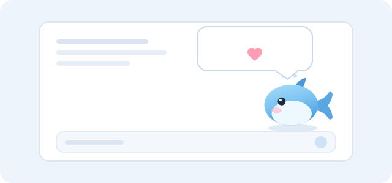

# 小鲸鱼桌宠 · dsh-whale-pet



在 DSH（DeepSeek Harness）的 Web / 桌面界面里养一只小鲸鱼。它漂浮在界面浮层上，不属于任何工作区：装一次，之后每个会话都会陪着你。

纯 DOM + CSS 绘制，不加载图片、不发网络请求、不上报数据，也没有任何运行时依赖。

## 特性

- 漂浮在 `shell.overlay` 浮层里，会自己游动、转向、眨眼、偶尔吐泡泡
- 4 种互动：单击、双击、长按、拖动；鼠标靠近时眼睛会跟着看
- 按当前时段说话（深夜劝睡、早上问好、白天闲聊），静置时也会自己冒情绪
- 逐帧动画直接写 DOM，React 只在首屏渲染一次，稳定 33ms 一帧
- 收起 / 关闭只需在 Plugins 里关掉 `whale-pet` 这一行

## 互动

| 操作 | 反应 |
|---|---|
| 单击 | 拍一下：身体压扁弹起 + 水花 + 随机台词 |
| 双击 | 摸摸头：跳起来 + 冒爱心 |
| 长按 0.6 秒 | 抱起来：转圈 + 冒星星 |
| 拖动 | 拎走，松手掉落 |
| Ctrl / ⌘ + 单击 | 哄睡觉，再点一下叫醒 |
| 鼠标靠近 | 眼睛跟着鼠标看 |
| 不管它 | 会自己游动、眨眼、按时间段说话 |

## 安装

### 方式 A：从本地目录安装（推荐）

1. 克隆本仓库：

   ```bash
   git clone https://github.com/a643036114-sys/dsh-whale-pet.git
   ```

2. 打开 DSH 的 **Plugins** 面板，点 **添加插件 / Add plugin**，选择克隆下来的目录。
3. 新开一个会话，右下角就会出现小鲸鱼。

仓库根目录就是插件包本身（`package.json` 里的 `dsh.bundle.patch` 指向 `cordis.patch.yml`），不需要构建：`lib/` 里放的是已经打包好的浏览器半。

### 方式 B：手工安装（不使用插件管理器时）

只把运行需要的文件放进当前 profile 的 `node_modules`（`$env:DSH_PROFILE_DIR` 在 DSH 的终端里可用；普通 PowerShell 里是 `C:\Users\<你>\.dsh\profiles\<profile>`）：

```powershell
$dst = "$env:DSH_PROFILE_DIR\node_modules\dsh-whale-pet"
New-Item -ItemType Directory -Force $dst | Out-Null
Copy-Item package.json, cordis.patch.yml, icon.svg $dst
Copy-Item lib, locale, docs $dst -Recurse
```

然后在 `$env:DSH_PROFILE_DIR\cordis.patch.yml` 顶层的 `insert:` 列表里加一行，重启 DSH：

```yaml
- insert:
    - id: whale-pet
      name: dsh-whale-pet
```

> 之前用旧办法手工装过的话，先把 profile 里旧的 `whale-pet` 行删掉再装 bundle，否则会出现两行、两只鲸鱼。

## 关闭 / 卸载

- 暂时不想要：Plugins 里把 `whale-pet` 这一行设为关闭
- 彻底移除：Plugins 里停用或移除本 bundle

## 目录结构

```text
.
├── package.json          # dsh.bundle.patch + dsh.client 声明
├── cordis.patch.yml      # 插入 whale-pet 这一行
├── lib/index.js          # Host 半：空 apply，只为让 Loader 能看见这一行
├── lib/client.js         # 浏览器半：__ModuleLoader__ 格式，桌宠本体
├── locale/{en,zh}.json   # 插件列表里的标题与描述
├── docs/                 # 详情页插图与说明
├── icon.svg              # 插件图标
└── dev/                  # 开发期脚本，不参与安装
```

## 兼容性

- 只对 DSH 的 Web / 桌面端浏览器面生效（`dsh.client.platform: "web"`）；CLI、headless、SDK profile 没有界面，装了也不会显示
- 依赖客户端现有的 `shell.overlay` 槽位和 `timer` 服务，未在更旧的 DSH 版本上测试
- 鲸鱼位于浮层，位置不持久化，重启后回到右下角

## 开发

```bash
node dev/verify-bundle.mjs lib/client.js   # 校验 bundle 契约（apply + inject timer）
```

`dev/whale-preview.html` 是独立演示页，调动画时比反复重装快；其余 `dev/` 脚本是早期的控制台注入版与本地调试服务，留档用，详见 [dev/README.md](dev/README.md)。

## English

**Whale desktop pet for DeepSeek Harness.** A small CSS-drawn whale floats in a DSH interface overlay. Click to poke it, double-click to pat it, hold to hug it, and drag it anywhere; it blinks, naps, wanders, and talks at the right time of day. No images, no network requests, no runtime dependencies.

Install: clone the repo, open **Plugins** → **Add plugin** in DSH, and pick the cloned directory. Turn off the `whale-pet` row to hide it.

## License

[MIT](LICENSE)
